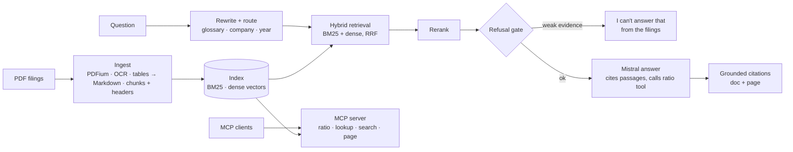

> **Learner starter.** This repo is generated from the reference solution.
> Work through `labs/` week by week and replace each `TODO` until `make exercises` is green
> (`make test` stays green throughout).
> Do not open the reference repo until you have tried each exercise yourself.

# fde-02-llm-applications: document assistant over company filings

Phase 2 (weeks 11–15) and **Capstone 1** of the **Forward Deployed ML Engineer: Zero-to-Hired** series. You build the most requested LLM system in enterprise work: an assistant that answers questions from a customer's own documents. It **cites the page every figure comes from**, and **says so when the documents don't contain the answer**.

**The system:** `filing-assistant`, a typed and tested Python package with a CLI, a streaming FastAPI service, a web UI and an MCP tool server, over public company filings (10-K, 10-Q, 8-K, earnings releases):

- **Ingestion:** PDF → pages (PDFium) with **OCR** for scanned pages (Tesseract). Financial statements are kept whole as **Markdown tables**. Chunks carry a contextual header (filing, page, section).
- **Retrieval:**
  - **BM25 written from scratch** plus dense vectors (`mistral-embed`, or an offline LSA embedder), combined with **reciprocal rank fusion**.
  - **Query rewriting** with a finance glossary ("capex" → "purchases of property, plant and equipment").
  - **Filing routing** by company and fiscal year.
  - A **reranker**: an offline lexical one, or a Mistral grader.
- **Guardrails (v1.1):** instruction-like sentences are quarantined and personal data masked at ingestion. Advice, personal-data, unknown-company and out-of-scope questions are declined. Answers are checked on the way out (ADR-008, measured by [fde-03](https://github.com/sundayayandele/fde-03-evaluation)).
- **Answers:** Mistral (or any provider in `config/providers.yaml`) answers only from numbered passages, cites them as `[n]`, and calls a **`financial_ratio` tool** for arithmetic. A **refusal gate** stops before any model call when the evidence is too weak. Without an API key, an **extractive baseline** answers offline.
- **Interfaces:**
  - `POST /api/v1/ask` (with tool calls) and `POST /api/v1/ask/stream` (server-sent events).
  - A web UI with clickable citations that open the PDF page.
  - An **MCP server** (`filing-assistant mcp`) exposing ratio, filing-lookup, search and page tools to Claude Desktop, Claude Code or any MCP client.



## Quick start

```bash
python3.12 -m venv .venv && source .venv/bin/activate
make install                     # also install Tesseract: apt install tesseract-ocr / brew install tesseract
make ingest-demo                 # fictional demo filings, offline, seconds
make run                         # UI on http://127.0.0.1:8000/
```

Real filings and the benchmark:

```bash
make download                    # FinanceBench: 150 questions + 84 PDFs, pinned commit
make ingest                      # ~6 minutes on 2 vCPU: 12,013 pages → 49,331 chunks
export MISTRAL_API_KEY=...       # optional: without it, answers are extractive
make ask Q="What is the FY2018 capital expenditure amount (in USD millions) for 3M?"
make eval                        # retrieval, refusal and extractive answers
make eval-llm                    # Mistral answers + LLM judge on the test half (costs cents)
```

## Results

Measured with the commands above on **FinanceBench (open-source sample)**: 150 questions over 84 filings, commit `cc39aeb4afdf`. Date 2026-10-15 (UTC). Raw reports are in [`evals/results/`](evals/results/).

> TODO week-15 results table: complete this section (see labs/).

## Run it everywhere

| Path | Command | What runs |
| --- | --- | --- |
| Local Python | `make install && make e2e` | Demo index, API, smoke checks (extractive mode) |
| Docker Desktop | `make up-docker` | Image with a baked index: 6 FinanceBench filings + demo (`CORPUS=sample`) |
| Podman Desktop | `make up-podman` | Same image as a pod; Mistral key from an optional secret |
| Rancher Desktop | `make up-rancher` | Same image on Rancher's moby engine |
| Local Kubernetes | `make k8s-docker`, `make k8s-rancher`, `make k8s-kind` | Deployment, HPA, PDB, NetworkPolicy |
| OpenShift / Helm | `oc apply -k deploy/openshift` · `helm install` | Route with edge TLS; key from a Secret |
| AWS / Azure / GCP | `make tf-aws-plan` (and `azure`, `gcp`) | Fargate, Container Apps, Cloud Run; key in each cloud's secret store |

Image corpora: `docker build --build-arg CORPUS=demo|sample|full`. Set `MISTRAL_API_KEY` at run time for LLM answers. Step by step: [desktop labs](docs/learning/DESKTOP-LABS.md), [cloud labs](docs/learning/CLOUD-LABS.md), [deployment](docs/DEPLOYMENT.md).

## Use it from Claude Desktop or any MCP client

```json
{"mcpServers": {"filing-assistant": {
  "command": "/path/to/.venv/bin/filing-assistant",
  "args": ["--index-dir", "/path/to/fde-02-llm-applications/index", "mcp"]}}}
```

Tools (all read-only): `financial_ratio`, `list_ratios`, `filing_lookup`, `search_filings`, `get_page`. HTTP transport: `filing-assistant mcp --transport streamable-http`.

## API

| Endpoint | Returns |
| --- | --- |
| `GET /` | Web UI: streamed answer, clickable `[n]` citations, sources with "open PDF page" links |
| `POST /api/v1/ask` `{question, docs?}` | `answer`, `citations` (doc, page), `refused`, `refusal_reason`, `hits`, `tool_calls`, `timings_ms`, `usage`, `cost_usd` |
| `POST /api/v1/ask/stream` | Server-sent events: `hits`, `token`…, `done` (citations, usage, cost) |
| `POST /api/v1/search` `{query, k, docs?}` | Passages with doc, page and scores |
| `GET /api/v1/filings?company&year&type` | Indexed filings |
| `GET /api/v1/filings/{doc}/pages/{n}` · `/pdf` | Extracted page text · the PDF |
| `POST /api/v1/tools/ratio` | Exact ratio calculation |
| `GET /health/*`, `GET /metrics/` | Health; questions, refusals, answer time, tokens, estimated cost, invalid citations |

## Learning path

| Week | Lab | You build |
| --- | --- | --- |
| 11 | [LLM APIs, prompts and citations](labs/week-11-llm-apis-and-citations/README.md) | `build_messages`, `parse_citations` |
| 12 | [Ingestion: PDFs, OCR and tables](labs/week-12-ingestion/README.md) | `table_to_markdown`, `chunk_text` |
| 13 | [Retrieval: BM25, dense and hybrid](labs/week-13-retrieval/README.md) | `bm25_idf`, `bm25_tf`, `rrf_fuse` |
| 14 | [Grounding: refusal, tools and MCP](labs/week-14-grounding-tools-mcp/README.md) | `should_refuse`, `compute_ratio` |
| 15 | [Evaluate, serve and present](labs/week-15-evaluate-and-serve/README.md) | `recall_at_k`, `numeric_match`, results table |

**Capstone 1 exit check:** from a fresh clone, `make test`, `make exercises` and `make e2e` pass. The FinanceBench index builds. Your results table has retrieval recall, refusal rates and answer accuracy, with latency and cost per question. The assistant runs in a container on one desktop engine and is usable from an MCP client. Your write-up names five failure cases and what you would do next.

## Repository map

```text
app/main.py, app/static/   API (JSON + SSE) and web UI
src/filing_assistant/      ingest, index, bm25, embed, retrieve, query, router, rerank, answer,
                           tools, pipeline, evaluate, financebench, demo, llm, mcp_server, cli
tests/                     unit, pipeline, MCP, API and CLI tests; e2e/smoke.yaml
evals/results/             committed FinanceBench reports behind the results table
labs/                      weeks 11–15
docs/                      architecture, ADRs, customer brief, system card, evaluation, datasets, security, cost
deploy/ · terraform/ · monitoring/
```

## Reference and starter

[`fde-02-llm-applications`](https://github.com/sundayayandele/fde-02-llm-applications) is the **reference** repo: complete code and measured results. [`fde-02-llm-applications-starter`](https://github.com/sundayayandele/fde-02-llm-applications-starter) is generated from it with `make starter`: each exercise becomes a `NotImplementedError("TODO ...")` stub, exercise tests carry `@pytest.mark.exercise` (`make exercises`), and the results table is blank for your numbers.

## Licence

Code: [MIT](LICENSE). Written content: [CC BY-SA 4.0](LICENSE-CONTENT.md). FinanceBench is downloaded at run time and not redistributed. Its repository has no licence file; the Hugging Face card lists CC BY-NC 4.0 (verify), so use it for learning and evaluation, not commercially. The filings themselves are public SEC documents. "Northwind Retail" in the demo corpus is fictional. See [DATASETS](docs/datasets/DATASETS.md).

Part of [fde-zero-to-hired](https://github.com/sundayayandele/fde-zero-to-hired) by Sunday Ayandele.
