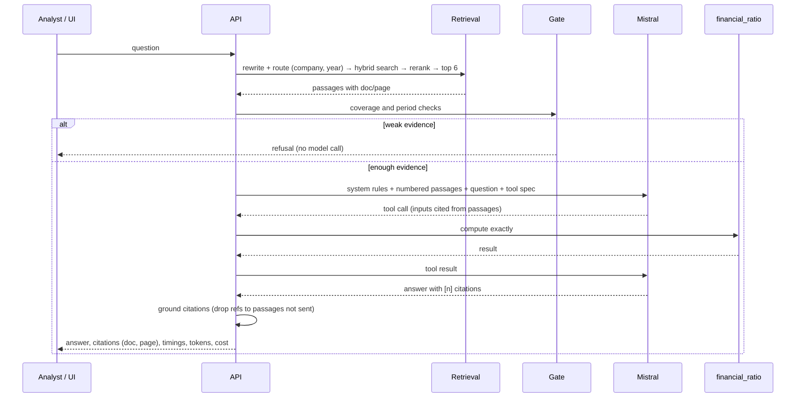

# Architecture

## Purpose

Answer analysts' questions from a customer's own documents, with a citation for every figure, and refuse rather than guess. Phase 2 builds it on public company filings so every number can be checked.

## Components

| Component | Module | Responsibility |
| --- | --- | --- |
| Ingestion | `ingest.py` | PDFium text per page; Tesseract OCR when a page has no text layer; statement tables detected and rendered as Markdown; chunks with contextual headers |
| Index | `index.py` | `chunks.jsonl` + `manifest.json` + dense vectors as `.npy`; BM25 rebuilt at load; no pickles |
| Lexical search | `bm25.py` | Okapi BM25 from scratch with an inverted index and document masks |
| Dense search | `embed.py` | `mistral-embed`, or LSA (TF-IDF + SVD) offline |
| Query handling | `query.py`, `router.py` | Strip instruction boilerplate, expand finance vocabulary; route to the company's filings and fiscal period |
| Retrieval | `retrieve.py` | BM25, dense or hybrid via reciprocal rank fusion |
| Reranking | `rerank.py` | Lexical (coverage, fiscal years, statement cues) or a Mistral grader |
| Grounding | `answer.py` | Prompt with numbered passages, citation parsing and grounding, refusal gate, extractive baseline |
| Tools | `tools.py`, `mcp_server.py` | Exact ratio calculator and filing lookup, for the model (function calling) and for MCP clients |
| Orchestration | `pipeline.py` | `ask()` (tool loop) and `ask_stream()` (events) |
| Evaluation | `evaluate.py`, `financebench.py` | Recall@k, MRR, refusal rates, numeric match, LLM judge, latency and cost |
| Interfaces | `app/main.py`, `cli.py` | REST + SSE + UI; CLI for ingest, ask, eval, MCP |

## Request flow (`/api/v1/ask`)

Streaming (`/ask/stream`) follows the same path without the tool loop (see [ADR-006](../adr/ADR-006-streaming-and-tools.md)).

## Decisions

| Decision | Record |
| --- | --- |
| Retrieval design: hybrid + rewrite + routing + rerank, with the ablation behind it | [ADR-004](../adr/ADR-004-retrieval-design.md) |
| Refuse before the model when evidence is weak | [ADR-005](../adr/ADR-005-refusal-gate.md) |
| Tools in `/ask`, plain streaming in `/ask/stream` | [ADR-006](../adr/ADR-006-streaming-and-tools.md) |
| Models: Mistral Small to answer, Mistral Large to judge, offline fallbacks | [ADR-007](../adr/ADR-007-models-and-offline-fallbacks.md) |
| Provider-agnostic client with a data-residency guard | [ADR-002](../adr/ADR-002-llm-provider-abstraction.md) |
| Same deployment matrix as every series repo | [ADR-003](../adr/ADR-003-deployment-matrix.md) |

## Limits

- Single-turn questions; no conversation memory.
- One index per deployment, loaded in memory: about 1 GB RAM for all 84 FinanceBench filings.
- Tables spanning pages are separate chunks; multi-page evidence is a known weakness.
- The refusal gate checks coverage and periods, not meaning: a fluent passage about the wrong metric can still pass it. The model's own refusal rule is the second line, and `fde-03` measures both.
