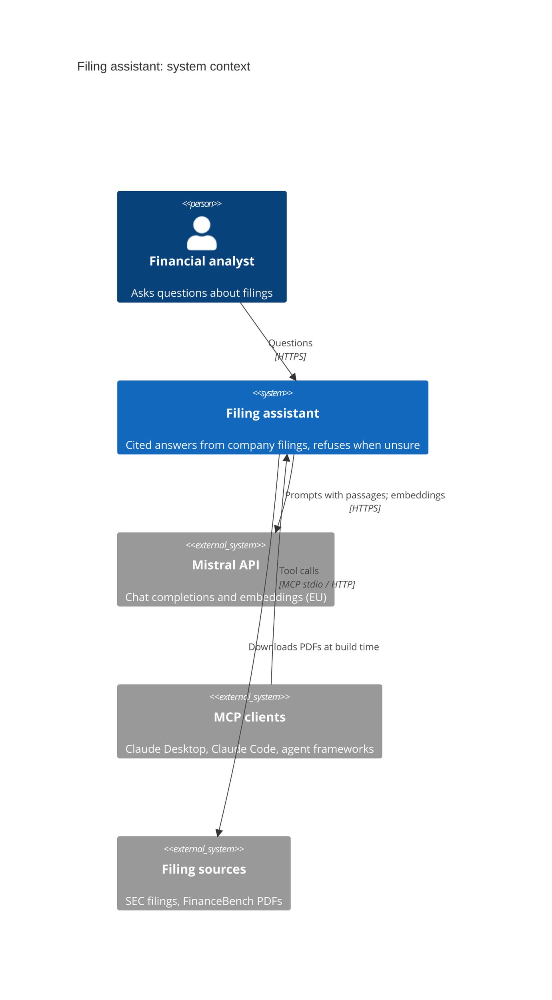
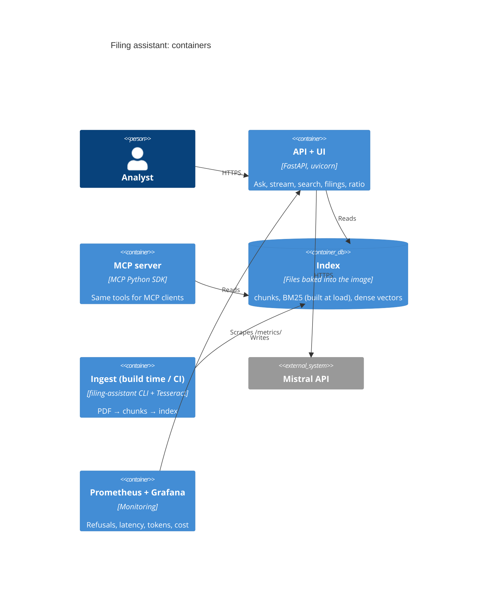

# C4 views

## Level 1: System context

## Level 2: Containers

## Level 3: Components

See the component table in [ARCHITECTURE](ARCHITECTURE.md). Diagram sources: [`diagrams/source/`](../../diagrams/source/).
